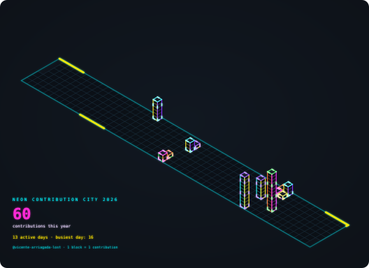
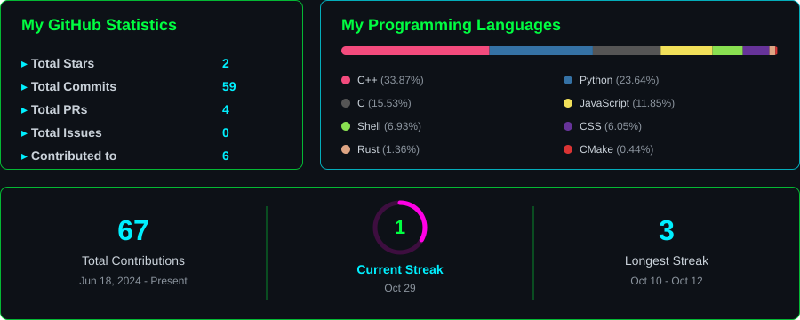

<div align="center">

<a href="https://git.io/typing-svg">
  
</a>

<br/>


</div>

---

## 🐱 About Me

```bash
$ whoami
vicente-arriagada-lost   # "Lost" · Santiago, Chile 🇨🇱

$ cat about.txt
Cybersecurity + Full-Stack developer in the making.
I like understanding how systems break so I can build them to resist it.
Python and C++ are my daily drivers; I'm adding web security and
modern full-stack (React, Node.js) to the loadout.

$ cat now.txt
> Learning web security fundamentals (OWASP Top 10) and networking
> Building small tools in Python and C++
> Practicing on CTFs / labs and documenting what I learn
```

---

## 🏙️ `> ./city.sh --year=2026` — The city I built this year

<div align="center">



<sub>Every building is a day; taller means more contributions. Updated daily by GitHub Actions.</sub>

</div>

---

## ⚔️ `> cat inventory.txt` — Skill Tree

<div align="center">

**🧠 Core languages**


**🔐 Cybersecurity** — *learning path*


**🌐 Full-Stack** — *learning path*


**🗄️ Databases & DevOps**


</div>

---

## 🛠️ `> ls ~/projects` — Loot

| Project | Stack | What it is |
|:--|:--|:--|
| [**ASCII_Motion**](https://github.com/vicente-arriagada-lost/ASCII_Motion) |  | Turns media into animated ASCII art (powers the portrait above). |
| [**iPop-Manager**](https://github.com/vicente-arriagada-lost/iPop-Manager) |  | C++ project. <!-- TODO: add a one-line description --> |

---

## 📊 `> ./stats --player=vicente-arriagada-lost`

<div align="center">



<sub>Generated daily by GitHub Actions straight from the GitHub API.</sub>

</div>

---

## 🏆 `> unlock --achievements`

<div align="center">


</div>

---

## 🎯 `> cat current_quests.log`

```diff
+ [ACTIVE]    🔐 Learning: Web security fundamentals (OWASP Top 10), networking, Linux
+ [ACTIVE]    🌐 Learning: Full-stack — React, Node.js, REST APIs & auth
+ [ACTIVE]    🧪 Practicing: CTFs & hands-on labs (TryHackMe / Hack The Box)
! [PENDING]   🛡️ Goal: Build a full-stack app with security-first design (auth, validation, hardening)
! [PENDING]   🔎 Goal: Write up CTF / lab solutions and publish them here
! [PENDING]   📜 Goal: Earn an entry-level security certification
- [LOCKED]    👑 Boss Fight: Land a role as a Security Engineer / Secure Full-Stack Developer
```

---

## 🎧 `> now_playing --mode=focus`

<div align="center">


</div>

---

## 📡 `> ping --connect`

<div align="center">

<a href="https://github.com/vicente-arriagada-lost"></a>
<!-- Reemplaza con tus datos reales y descomenta:
<a href="mailto:TU_CORREO"></a>
<a href="https://www.linkedin.com/in/TU_USUARIO"></a>
-->

<br/><br/>

```bash
$ echo "There is no spoon. Only data." | lolcat
$ nmap -sV --script vuln localhost   # always scan your own house first 🔐
$ python3 -c "print('Hello, World! 🧠')"
$ exit 0   # GAME OVER? Nah — INSERT COIN TO CONTINUE 🪙
```


</div>

<p align="center"><sub>Lost · <a href="https://www.gitskins.com/readme-generator?template=community-night-shift-zckz">Night Shift</a> template by <a href="https://www.gitskins.com/creators/Avijit010325">@Avijit010325</a> · generated with <a href="https://www.gitskins.com/readme-generator">GitSkins</a></sub></p>
